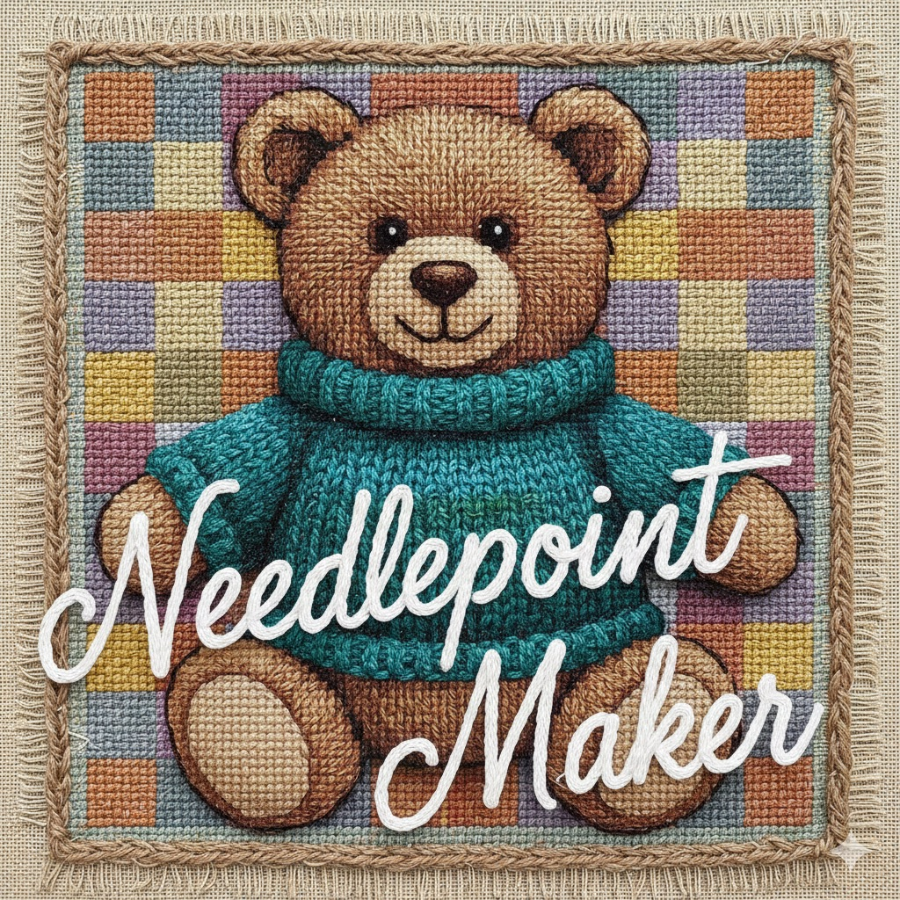

<h1>
  
  Needlepoint Maker
</h1>

A web application that transforms any image into a needlepoint canvas pattern, complete with color-coded stitch guides and downloadable outputs. Built with HTML, CSS, and JavaScript because why use many tools when few do trick?

**Live Demo:** [needlepointmaker.com](https://needlepointmaker.com/)

## Why I Built This

My wife enjoys needlepoint as a hobby, but finding patterns for specific images she wanted to stitch was difficult. Commercial pattern generators often produce results with too many colors or awkward dimensions. This tool gives her full control over the conversion process—she can adjust the canvas size, limit the color palette, and export everything needed to start stitching.

## Features

- **Image to Pattern Conversion**: Upload any image and convert it to a grid-based needlepoint pattern
- **Project Size Presets**: Quick selection for common project types (Coaster, Ornament, Pillow, Wall Art) with smart aspect ratio matching—presets that would stretch your image are automatically disabled
- **Canvas Mesh Options**: Choose between 13 mesh (larger stitches) or 18 mesh (finer detail) canvas
- **Flexible Dimensions**: Enter dimensions in inches or stitches, with automatic conversion based on mesh count
- **Aspect Ratio Lock**: Optionally lock aspect ratio to prevent image distortion
- **Color Palette Control**: Limit the number of colors with perceptual quantization that preserves distinct accents
- **Editable Palette Colors**: Select a legend color, highlight every matching stitch, and replace that color across the pattern
- **Interactive Grid**: Zoom in/out, toggle color codes, and show/hide grid lines
- **Color Legend**: View all colors with their codes, hex values, and stitch counts
- **Edit Settings**: Modify dimensions or colors of a converted project without re-uploading
- **Project Management**: Automatically saves projects to browser storage for later access
- **Privacy-conscious Product Feedback**: Anonymous usage events, feature-intent prompts, explicit feedback, and a browser-level analytics opt-out
- **Multiple Export Options**:
  - Grid CSV (stitch-by-stitch color codes)
  - Legend CSV (color reference chart)
  - Preview PNG (quantized image)
  - Grid Image PNG (full pattern with codes)

## Usage

### Running the Application

Open `index.html` in a web browser. No build step or server required.

```bash
# macOS
open index.html

# Linux
xdg-open index.html

# Or simply double-click index.html in your file manager
```

### Converting an Image

1. Click **+ New Project** or drag an image onto the dropzone
2. Select a **Project Size** preset or choose Custom:
   - Coaster (4" × 4")
   - Ornament (3" × 4")
   - Pillow (8" × 8")
   - Wall Art (6" × 8")
   - Presets that don't match your image's aspect ratio are automatically disabled
3. Choose your **Canvas Mesh** (13 or 18 intersections per inch)
4. Adjust **Dimensions** if needed:
   - Toggle between Inches and Stitches units
   - Enable/disable aspect ratio lock
5. Set **Maximum colors** as a ceiling. The converter automatically uses fewer thread colors when additional shades add little detail.
6. Click **Convert**

### Viewing Results

After conversion, you'll see:
- Pattern dimensions and physical size (e.g., "72 rows × 72 columns (4" × 4" at 18 mesh)")
- **Edit Settings** button to go back and adjust dimensions or colors
- Display controls:
  - **Cell Size**: Slider to zoom the grid view
  - **Hide/Show Codes**: Toggle color code labels on each cell
  - **Toggle Grid Lines**: Show or hide the grid borders

### Exporting Patterns

Use the download buttons:

- **Download Grid CSV**: A spreadsheet with color codes for each stitch position
- **Download Legend CSV**: A reference table mapping codes to hex colors and counts
- **Download Preview PNG**: The quantized image at canvas resolution
- **Download Grid Image**: A high-resolution image of the pattern grid with codes

### Managing Projects

- Projects are automatically saved to browser local storage
- Click any project in the sidebar to reload it
- Click **Edit Settings** to modify dimensions or colors of a saved project
- Click the **×** button to delete a project
- Use **Clear All Projects** to remove all saved data

## Technical Details

### Color Quantization

The application selects a palette in [Oklab perceptual color space](https://bottosson.github.io/posts/oklab/):

1. Sample the original image at up to 512 pixels on its longest edge, compositing transparency onto white. Select colors before resizing to stitches so small accents are not lost to blending.
2. Group nearby source colors in a bounded histogram, then choose deterministic seeds using visual distance and square-root frequency. This balances dominant colors with smaller, distinct accents.
3. Try progressively larger palettes, refining each with pixel-weighted clustering. Stop at the smallest palette that meets the perceptual fidelity budget, up to the requested ceiling. Near-identical shades can share a thread; distinct flat colors stay separate.
4. Check for supported hue families absent from the palette. Replace a redundant nearby shade when possible, while protecting the dominant color, highlights, shadows, and hues already represented.
5. Resize the image to the stitch grid and map pixels to the nearest palette color in Oklab, emphasizing hue to avoid mapping skin tones or accents onto unrelated background colors. Cache repeated mappings and count only colors actually used.

Palette sizing checks both source colors and the resulting stitch grid, so resampling blends and compression texture do not force extra threads. The quality budget is a practical heuristic, not a mathematically unique optimum. The Christmas ornament uses six or seven colors under a ceiling of 30; photographs can use more.

Existing saved patterns keep their palettes until the user converts them again. Very fine details still depend on stitch resolution and the selected color limit.

Run the dependency-free regression tests with:

```bash
node --test tests/*.test.cjs
```

For the broader visual suite, serve the repository locally and open
[`tests/browser-color-validation.html`](tests/browser-color-validation.html).
It generates 19 deterministic patterns and tests four saved image fixtures plus
the existing bear artwork at three stitch sizes and eight color limits. An
optional `?baseline=/path/to/previous-app.js` adds before/after comparisons.

[`tests/paired-pattern-validation.html`](tests/paired-pattern-validation.html)
compares eight original target grids against clean, shaded, lit, and JPEG source
variants. It scores stitch classification, perceptual color error, and thread
count at the intended budget and ceilings of 30 and 64. Source/reference provenance
and the external chart check are documented in
[`docs/implementation/adaptive-palette-validation.md`](docs/implementation/adaptive-palette-validation.md).

### Mesh Count Conversion

Dimensions can be entered in inches or stitches:
- **18 mesh**: 18 stitches per inch (finer detail, more stitches)
- **13 mesh**: 13 stitches per inch (larger stitches, faster to complete)

Example: A 4" × 4" project equals:
- 72 × 72 stitches at 18 mesh
- 52 × 52 stitches at 13 mesh

### File Structure

```
needlepoint/
├── images/       # Favicon, logo, and OG images
├── backend/      # Railway-hosted measurement and payment API
├── docs/         # Implementation roadmap and runbooks
├── index.html    # Application markup
├── styles.css    # UI styling
├── analytics.js  # Anonymous event delivery and privacy controls
├── app.js        # Core logic (quantization, rendering, storage)
└── README.md     # This file
```

### Browser Requirements

- Modern browser with ES6 support
- Canvas API for image processing
- LocalStorage for project persistence

## License

MIT

## Product Roadmap

Backend, measurement, product, monetization, and SEO implementation work is
tracked in the [implementation roadmap](docs/implementation/README.md).
